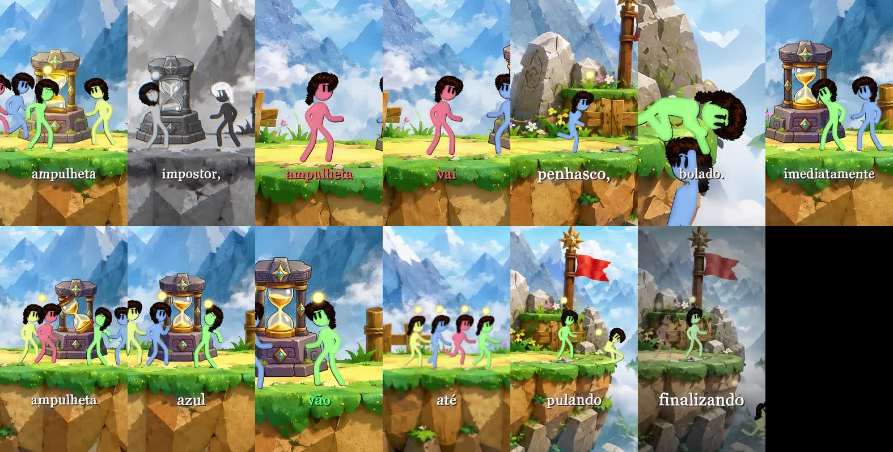

# IA Memory — TikTok: beleza e autocuidado
Atualizado em 12/11/2026. Escopo exclusivo: novos vídeos do TikTok de Iza. Não aplicar ao Boa Mesa ou à XM.

## Leitura obrigatória no início de cada vídeo
Leia esta memória e abra [o painel da referência](references/motion-contact-sheet.jpg) antes de escrever storyboard, gerar assets ou animar. Se houver uma correção posterior da usuária, atualize este documento distinguindo o que ela aprovou de propostas de produção. Não pedir novamente as direções visuais já registradas.

## Decisão expressa da usuária
“Só o Motion será a referência, nesse estilo de arte.”
“Todos os vídeos quero que sejam nesse design.”
A referência determina a linguagem de arte e animação. Não determina roteiro, personagens específicos, cenário literal ou assunto. Beleza, cabelo e autocuidado são os assuntos desta série; a história de jogo do vídeo original não deve ser copiada.

## Referência verificável
Arquivo recebido: videoplayback.mp4. Vertical, 720 × 1280, duração aproximada 51,17 s; arquivo inspecionado sem faixa de áudio.
O painel anexo contém amostras a cada quatro segundos, em ordem de leitura; o último espaço preto é sobra da montagem, não parte do estilo.
Original recebido na conversa em 12/11/2026. A cópia enviada pela usuária permanece associada à conversa de origem.
O MP4 original não está incorporado neste repositório. O painel preserva a aparência, mas não substitui o vídeo para estudar timing de movimentos; se necessário, recuperar o arquivo de origem, sem inventar observações de áudio.

## Linguagem visual a preservar
- Estética de jogo de plataforma em vista lateral: personagens 2D simples sobre cenário ilustrado com sensação de volume, uma combinação que pode ser descrita como 2,5D.
- Silhuetas humanas alongadas, braços e pernas finos, cabeças arredondadas, contorno escuro, poucas marcas faciais. A referência usa corpos com cores vivas e cabelo escuro.
- Contraste entre personagens simples e cenários mais detalhados: planos de fundo atmosféricos, superfícies texturizadas e objetos com volume.
- Profundidade legível: primeiro plano, plano de ação e fundo separados por escala, contraste e sobreposição.
- A referência usa azul-céu e montanhas azuis, verdes vivos, terras e dourados, personagens em verde, rosa, amarelo e azul. Esses tons descrevem o exemplo; não são uma paleta hexadecimal de marca aprovada.
- Ação e objetos ocupam a cena. Texto curto funciona como apoio de leitura, sem transformar o vídeo em sequência de cartelas.
- A legenda observada é clara, serifada, com sombra/contorno escuro e destaque pontual de palavras. Manter legibilidade no celular; o nome exato da fonte não foi identificado.

## Movimento e encenação
- Contar a explicação por ações dos personagens e interações com objetos, preservando sua identidade entre planos.
- Alternar planos que situam a cena e aproximações que destacam ações ou reações.
- Deslocamentos devem ter intenção e contato crível com o cenário; animar postura e membros quando a ação exigir, não apenas deslizar um recorte rígido.
- Usar continuidade espacial e transições motivadas pela narrativa.
- Preservar a hierarquia: uma ação principal por momento, elementos de apoio subordinados e legendas sem cobrir a interação.
- Ritmo exato, curvas de animação, duração dos planos e movimentos de câmera devem ser avaliados no MP4 quando disponíveis; não tratar valores arbitrários como aprovados pela usuária.

## Adaptação para beleza
Conservar desenho, proporções, profundidade e linguagem de movimento; mudar o ambiente e os objetos conforme o assunto.
Banheiro, penteadeira, embalagens, fios ampliados e elementos que representam conceitos são possibilidades propostas, não assets já aprovados.
Representações de processos cosméticos precisam ser identificáveis como ilustrações. Não simular prova de eficácia, antes/depois real ou resultado de uso.

## O que evitar
- Substituir o estilo aprovado por editorial creme/coral/vinho, slides corporativos, infográficos genéricos ou vídeo composto apenas de palavras animadas.
- Mudar radicalmente anatomia, traço, acabamento e linguagem de movimento a cada episódio.
- Copiar literalmente montanhas, penhasco, ampulheta, história ou personagens do original por serem parte da referência.
- Usar a identidade visual do Boa Mesa ou da XM nesta série.
- Deformações acidentais, membros inconsistentes, objetos sem contato, cortes de legenda e texto sob os controles da plataforma.
- Afirmar que usar Remotion, publicar mais de um minuto ou seguir este estilo garante monetização.

## Estado das decisões
APROVADO: base estética recorrente derivada do vídeo enviado; referência de arte e motion; aplicação a todos os vídeos desta série.
INTENÇÃO DA USUÁRIA: produzir vídeos com Remotion e reativar o TikTok em novo nicho.
PROPOSTAS AINDA NÃO VALIDADAS EM VÍDEO: primeiro episódio sobre hidratação/nutrição/reconstrução; duração de 70–80 s; voz feminina; ambientes e assets específicos.
EM ABERTO: nome do perfil, logo, elenco original definitivo, paleta exata, fonte licenciada, voz e trilha. Não inventar que já foram escolhidos. Propor escolhas coerentes sem reabrir o estilo geral.
O padrão desta série não se aplica automaticamente a outros projetos da usuária.

## Procedimento de produção
1. Ler este arquivo e examinar o painel; consultar o MP4 original quando necessário para timing.
2. Conferir novas orientações da conversa e pesquisar fontes confiáveis para as afirmações do roteiro.
3. Escrever roteiro e storyboard com ações concretas e estabelecer assets originais coerentes com a referência.
4. Implementar com Remotion, conforme solicitado, salvo nova orientação explícita da usuária.
5. Verificar proporções, consistência dos personagens, contato com objetos, profundidade, enquadramento e legibilidade.
6. Revisar o vídeo em movimento e escutar a narração; conferir texto, áudio, fontes factuais e eventuais regras atuais da plataforma.
7. Registrar feedback e escolhas realmente aprovadas nesta memória; guardar os novos assets de referência sem sobrescrever a fonte original.

## Prompt base reutilizável
Crie um episódio vertical de beleza/autocuidado para TikTok usando a referência visual desta pasta. Preserve personagens 2D simples, alongados, coloridos e com contorno escuro; cenários ilustrados em camadas com volume; estética de jogo de plataforma em vista lateral; ações e interações que expliquem a narrativa; enquadramentos abertos e aproximações; legendas curtas e legíveis. Adapte cenário e objetos ao tema, mantenha consistência entre cenas e episódios, e crie elementos originais. Não use slides editoriais como substituto. Consulte as decisões e restrições do IA_MEMORY.md antes da produção.

